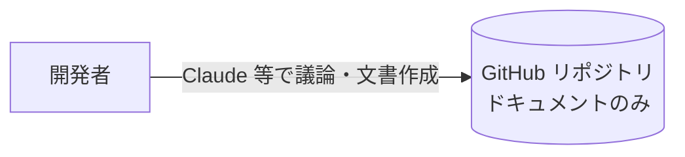
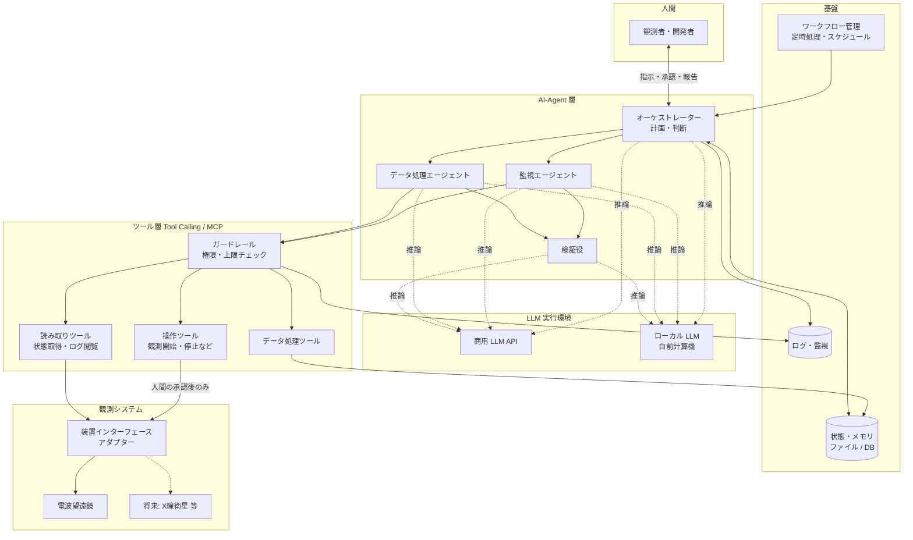
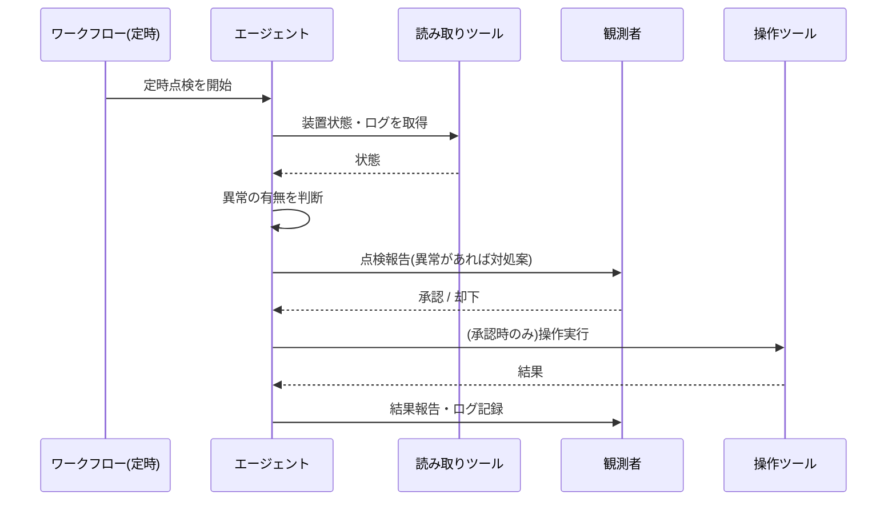
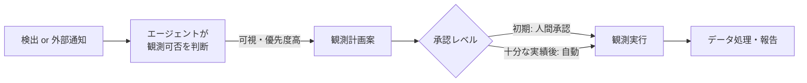

# ARCHITECTURE — システム構成

最終更新: 2026-11-16

> **重要:現時点で実装されているコンポーネントはありません。** 本書の構成はすべて **Proposed(提案)** です。採用が決まったものは ADR を作成し、ラベルを更新します。

## 1. 現時点の状態(Confirmed)

存在するのは本リポジトリ(ドキュメント)だけです。AI-Agent、観測装置との接続、データベースなどは未構築です。

## 2. 提案する全体構成(Proposed)

## 3. 各コンポーネントの役割(初心者向け説明付き)

| コンポーネント | 役割 | たとえると | 位置付け | ラベル |
|---|---|---|---|---|
| **LLM** | 文章を理解し、次の行動を考える | 頭脳 | 全エージェントが利用 | Proposed |
| **商用 LLM API** | 高度な判断(計画、原因推定)を担う | 外部の専門家に相談 | 難しい判断用 | Decided(併用方針)/ 製品は未定 |
| **ローカル LLM** | 定型的な要約・分類、通信断時の最低限の判断、データを外に出せない処理 | 所内の担当者 | 常時・大量処理用 | Decided(併用方針)/ 製品は未定 |
| **AI-Agent** | 目的に向かってツールを使い作業する | 担当者 | 中心 | Proposed |
| **オーケストレーター** | 仕事を分け、結果をまとめ、人間とやり取りする | 当番責任者 | 最初は単一エージェントがこれを兼ねる | Proposed |
| **Tool Calling** | LLM が「関数を呼びたい」と出力し、プログラムが実行する仕組み | 手足 | エージェントが外界に作用する唯一の経路 | Proposed |
| **MCP** | ツールを共通規格で公開し、複数の AI から使えるようにする | 共通コンセント | ツール層の実装方式の候補 | Proposed |
| **外部 API** | 天体情報、突発現象通知(例:VOEvent 系の配信)、天気など | 外部の情報源 | 読み取りツールとして接続 | Proposed |
| **ガードレール** | 禁止操作・安全範囲・承認要否をプログラムで強制 | 安全装置 | **すべての操作ツールの手前** に置く | Proposed |
| **ワークフロー管理** | 定時処理や決まった手順を確実に実行 | 時刻表 | エージェントを起動する側 | Proposed |
| **メモリ・状態管理** | 観測計画、装置状態の履歴、判断の経緯を保存 | 業務日誌 | LLM は記憶を持たないため必須 | Proposed |
| **データベース** | 状態・ログ・観測記録の構造化保存 | 台帳 | 最初はファイルで十分な可能性あり | Proposed |
| **装置インターフェース(アダプター)** | 望遠鏡固有の制御方式を共通の関数に変換 | 通訳 | **装置ごとに差し替える部分**。汎用化の鍵 | Proposed(制御方式は未確認) |
| **ローカル計算機での処理** | 観測データ処理、ローカル LLM の実行 | 作業場 | 大容量データは外部に送らない | Proposed |
| **ログ・監視・エラー処理** | エージェントの全判断・操作・結果を記録し、異常時に通知 | ブラックボックス + 警報 | 最初から組み込む | Proposed |

## 4. 設計の基本方針(Proposed)

1. **装置固有部分と共通部分を分ける。** 装置インターフェース(アダプター)だけを差し替えれば、X 線衛星など別の観測システムにも同じ仕組みを使える。
2. **「読む」と「動かす」を分ける。** 読み取りツールと操作ツールを別にし、操作ツールは人間の承認を必須にする([ADR-0006](DECISIONS/ADR-0006-human-in-the-loop-safety.md))。
3. **決まった手順はワークフロー、判断だけエージェント**([BASICS §3](BASICS.md#3-ワークフローとエージェントの使い分け))。
4. **単一エージェントから始める**([ADR-0007](DECISIONS/ADR-0007-start-with-single-agent.md))。上図のワーカー・検証役は将来の分割候補。
5. **状態はファイル/DB に置く。** 会話の記憶に頼らない。

## 5. データ・処理の流れ(Proposed)

### 5.1 日常運用(最初の目標)

### 5.2 突発天体の追観測(将来構想、Planned)

## 6. 現状と将来の区別(まとめ)

| 範囲 | 状態 |
|------|------|
| ドキュメント基盤 | Confirmed(本リポジトリ) |
| 上記 §2〜§5 の構成すべて | Proposed |
| 突発天体の自動追観測・長期自律運用 | Planned(構想) |
| 装置インターフェースの具体的方式 | Unverified(望遠鏡の制御方式が未確認) |
