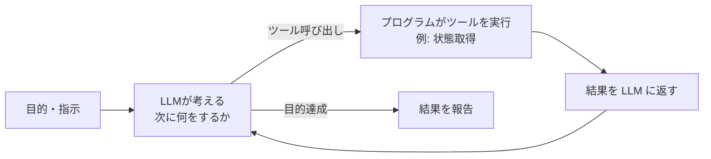

# BASICS — AI-Agent の基礎知識

AI-Agent 開発が初めての人向けの解説です。ここに書くのは **一般的な知識** であり、本プロジェクトでの採用・検証状況とは別です(採用状況は [TECH_STACK](TECH_STACK.md) を参照)。用語は [GLOSSARY](GLOSSARY.md) も参照してください。

## 1. チャット AI と AI-Agent の違い

| | チャット AI | AI-Agent |
|---|---|---|
| 入力 → 出力 | 質問 → 回答 | 目的 → 一連の行動と結果 |
| 外部への作用 | しない(文章を返すだけ) | ツールを呼んで外部に作用する |
| 手順 | 人が決める | エージェントが自分で決める(範囲内で) |
| 失敗の影響 | 間違った文章 | 間違った **操作**(装置・データに影響しうる) |

最後の行が、観測装置を扱う本プロジェクトで安全設計を重視する理由です。

## 2. エージェントの基本ループ

重要なのは、**LLM 自身は何も実行しない** ことです。LLM は「このツールをこの引数で呼んで」と出力するだけで、実際の実行は私たちが書くプログラムが行います。したがって「何を実行させてよいか」はプログラム側で完全に制御できます。

## 3. ワークフローとエージェントの使い分け

- **ワークフロー**:手順が決まっている処理(例:毎晩 23 時にデータを転送して処理する)。通常のプログラムやスケジューラで十分で、予測可能・安全。
- **エージェント**:状況に応じた判断が必要な処理(例:異常ログを読んで原因を推定し、対処案を出す)。

> 一般的な推奨:**決まった手順はワークフローで書き、判断が必要な部分にだけ LLM を使う。** 何でもエージェントにすると、遅く・高く・予測しにくくなります。

## 4. マルチエージェント(エージェント家族)の考え方

複数のエージェントに役割を分ける構成です(例:計画役、実行役、検証役)。公開されている事例から得られた要点(出典は [references/agent-family-playbook.md](references/agent-family-playbook.md)):

- 分担の利点は、**並列化**、**情報の分離**(それぞれが自分の仕事に必要な情報だけを持つ)、**独立した検証** の 3 つ。
- 一方で、調整の複雑さとトークン消費(コスト)が大きく増える。
- 推奨される始め方:**まず 1 つのエージェントで試し、具体的な問題が見えてから役割を分ける。**
- 「作業した本人に自分の結果を採点させない」:検証役を分けることが信頼性向上に効く。

## 5. 安全設計の基本

| 手法 | 内容 |
|------|------|
| 読み取り専用から始める | 最初は「状態を見る」ツールだけを与え、「操作する」ツールは与えない |
| 人間の承認(HITL) | 装置操作などの前に人間が確認・承認する |
| ガードレール | 禁止操作・上限値をプログラム側で強制する(LLM への指示文だけに頼らない) |
| ログ | エージェントの判断・ツール呼び出し・結果をすべて記録する |
| 段階的な権限拡大 | 試験で信頼が確認できた操作から順に自動化する |

## 6. 評価(エージェントが「良くなった」をどう測るか)

1. 実際の業務から試験課題を 5〜20 個用意する(答えが分かっているものを含める)。
2. まず最小構成で実行し、成功率・時間・コストを記録する(ベースライン)。
3. 変更は **一度に 1 つだけ**(指示文、ツール、モデル、構成のいずれか)。
4. 全課題を再実行し、良くなった場合だけ変更を残す。

記録方法は [EXPERIMENTS/README.md](EXPERIMENTS/README.md) を参照してください。
