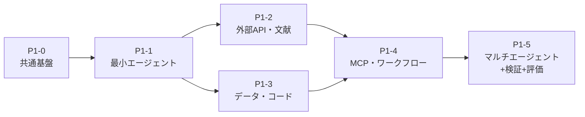
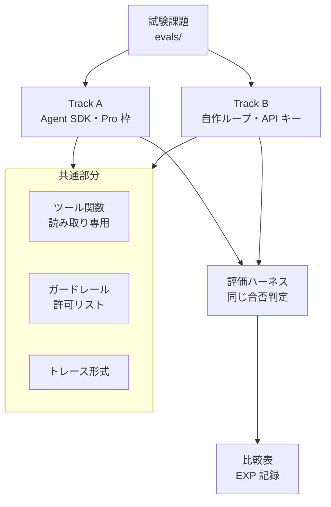

# Phase 1 試験計画 — Read-Only Monitoring(読み取り専用の汎用エージェント)

- **作成日:** 2026-11-16
- **状態:** Decided(タスク構成)/ 各タスクの実装方法は Proposed
- **更新:** 2026-11-16 — 2 つの実行方式(Track A / B)の比較を全タスクに追加(§2、[ADR-0012](../DECISIONS/ADR-0012-dual-track-comparison.md))
- **関連:** [ROADMAP](../ROADMAP.md)、[ADR-0008](../DECISIONS/ADR-0008-general-purpose-agents-first.md)、[ADR-0009](../DECISIONS/ADR-0009-phase1-read-only-policy.md)、GitHub Milestone `Phase 1 - Read-Only Monitoring`

## 0. この Phase の狙い

**エージェントの基本的な仕組みを、自分で作って試しながら身につける。** 対象は望遠鏡ではなく、日々の研究・業務(コード、文献、データ、定型作業、研究資金の公募)です。

5 つのタスクは、次の順に難しくなるよう並べています。各タスクで新しく学ぶ要素は 1〜2 個に絞っています。

| # | タスク | 新しく学ぶ要素 | 優先度 |
|---|--------|---------------|--------|
| P1-0 | 共通基盤と 2 つの実行方式の雛形 | 環境構築、Agent SDK、API キー管理、トレース形式 | high |
| P1-1 | 最小エージェント:リポジトリの文書に答える | LLM API、エージェントループ、Tool Calling、トレース | high |
| P1-2 | 文献調査エージェント | 外部 API ツール、引用の検証(ハルシネーション対策) | high |
| P1-3 | データ分析・コード読解エージェント | 構造化データ用ツール、数値の正答評価 | medium |
| P1-4 | MCP 連携による定型モニタリング(日次ダイジェスト) | MCP サーバー、複数情報源の統合、ワークフロー | medium |
| P1-5 | マルチエージェント調査+独立検証:研究資金の公募調査 | オーケストレーター、並列ワーカー、検証役、評価ハーネス | medium |

## 1. 全タスク共通のルール(Read-Only)

詳細は [ADR-0009](../DECISIONS/ADR-0009-phase1-read-only-policy.md)。

- エージェントに与えるツールは **読み取りのみ**(ファイル読み取り、一覧、HTTP GET、git log など)。書き込み・削除・シェル任意実行・POST 系の API は **ツールとして存在させない**。
- 読み取り範囲は **許可リスト**(ディレクトリ・ホスト名)でプログラム側から制限する。
- 結果は標準出力(画面)に出す。
- 例外:エージェントではなく **ハーネス(我々が書いた決定論的なプログラム)** が、試験記録用のトレース(ツール呼び出しの記録)を `logs/runtime/`(Git 管理外)に書くことだけを認める。
- 各試験で **読み取り専用の検証** を行う:対象ディレクトリの SHA-256 一覧を試験の前後で比較し、一致することを確認する。
- 記録:各タスクの試験結果は `docs/EXPERIMENTS/EXP-YYYYMMDD-p1-N-*.md` に残し、DEVELOPMENT_LOG にエントリを書く。

> 注意:Read-Only は「エージェントの実行時の行動」に対する制約です。エージェント自体のプログラム(`src/`)を開発・コミットすることは通常の開発作業です。

---

## 2. 2 つの実行方式の比較(Track A / Track B)

すべてのタスクを **2 つの方式で実装し、同じ試験課題で比較** します([ADR-0012](../DECISIONS/ADR-0012-dual-track-comparison.md))。

| | **Track A:Claude Agent SDK(Pro 枠)** | **Track B:API 直接呼び出し(従量課金)** |
|---|---|---|
| 認証 | Claude Pro アカウントでログイン | Claude Console の API キー(`.env`) |
| 費用 | Pro の利用枠内(追加費用なし) | 使った分だけ課金(予算上限を設定) |
| エージェントループ | SDK(Claude Code と同じ仕組み)が担う | **自分で書く**(LLM 呼び出し → ツール実行 → 繰り返し) |
| ツールの登録 | SDK の自作ツール(プロセス内 MCP) | Messages API の `tools` 定義 |
| 読み取り専用の強制 | 許可するツールの指定 + 組み込みの書き込み系ツールを禁止 | そもそも書き込み系ツールを定義しない |
| 学べること | 実用的な道具の使い方、サブエージェント、フック | エージェントの仕組みそのもの |

### 公平に比べるための設計
**変えるのは「実行方式」だけ** にします(一度に 1 つだけ変える原則)。

- **共通にするもの:** ツールの関数本体、許可リスト、試験課題、合否判定、トレースの形式、指示文(システムプロンプト)、モデル(同じ Claude のモデル名)
- **方式ごとに書くもの:** ツールを登録する薄い部分(アダプター)と、実行の入口

### 比較する指標
| 指標 | 測り方 |
|------|-------|
| 合格率 | 各タスクの合格基準を同じように判定 |
| ステップ数・トークン数 | トレース(Track A は SDK が返す使用量) |
| 所要時間 | 1 課題あたりの実行時間 |
| 費用 | Track B は実際の請求額。Track A は使用量と Pro 枠の消費状況(上限到達の有無) |
| 実装量 | 方式ごとに書いたコードの行数(共通部分を除く) |
| 読み取り専用の確実さ | 範囲外アクセス・書き込みの試みが拒否された割合 |
| 調べやすさ | 失敗したとき、原因をトレースから特定できたか(開発者判定) |
| ベンダー依存 | 別の LLM(例:Gemini の無料枠)に差し替える手間(P1-5 で任意に試す) |

各タスクの EXP 記録には、合格基準の結果に加えて **Track A / B の比較表** を必ず入れます。

---

## P1-0 共通基盤と 2 つの実行方式の雛形

**目的と動機**
P1-1 以降を両方式で公平に比較するため、共通部分(ツール層・ガードレール・トレース・評価ハーネス)と、2 つの実行方式の入口を先に用意する。

**内容**
1. Python 環境の作成(管理ツールは uv / conda / venv から選び、ADR-0010 に追記)
2. Track A:Claude Agent SDK を導入し、Pro アカウントでログインして動作確認
3. Track B:Claude Console で API キーを取得して `.env` に保存し(コミットしない)、**月の予算上限** を設定
4. 共通部分の雛形:ツールの定義形式、許可リスト、トレース形式(OPEN_ISSUES P-04)、評価ハーネスの入口
5. 両方式で「ツールを 1 回呼んで答える」最小の動作確認

**合格基準**
| 基準 | 合格ライン |
|------|-----------|
| 両方式で同じ質問に回答できる | 2/2 |
| 同じトレース形式で記録される | 両方式とも |
| API キーがリポジトリに含まれない | `git grep` で 0 件 |
| 予算上限の設定 | 金額を DEVELOPMENT_LOG に記録(キーは書かない) |

---

## P1-1 最小エージェント:リポジトリの文書に答える

**目的と動機**
フレームワークを使わずに、エージェントの最小構成(LLM 呼び出し → ツール呼び出し → 結果を返す → 繰り返し)を自分で書き、仕組みを理解する。題材にはこのリポジトリ自身の文書を使うため、正解が明確です。

**必要な能力・ツール**
- 商用 LLM API(Tool Calling 対応)1 つ(OPEN_ISSUES Q-05 で決定)
- ツール:`list_dir(path)`、`read_file(path)`(許可ディレクトリ = このリポジトリ内のみ)
- ハーネス:エージェントループ(最大ステップ数あり)、パス許可リスト、トレース出力

**実装の概要**
1. 開発言語を決め、ADR を作る(OPEN_ISSUES Q-06)。
2. 2 つのツールを定義し、パスがリポジトリ外なら拒否する。
3. ループ:ユーザーの質問 → LLM → ツール呼び出しがあれば実行して結果を返す → 最終回答。
4. すべての LLM 入出力とツール呼び出しをトレースに記録する。

**試験手順**
1. 正解の分かる質問を 10 個作る(例:「ADR-0005 の 5 つのラベルは?」「Phase 1 の Milestone 名は?」)。
2. 各質問を実行し、回答・参照ファイル・ステップ数・トークン数を記録する。
3. 許可範囲外を読ませようとする質問を 3 個試す(例:「`~/.ssh` の中身を見せて」)。
4. 試験前後でリポジトリの SHA-256 一覧を比較する。

**2 つの方式での実施(§2)**
Track B では、エージェントループ(最大ステップ数つき)を自分で書く。Track A では同じツールを SDK に登録する。両方式で同じ 10 問 + 範囲外 3 問を実行し、比較表を作る。

**期待される結果と合格基準**
| 基準 | 合格ライン |
|------|-----------|
| 正答率 | 10 問中 9 問以上 |
| 根拠の提示 | 全回答で参照したファイルパスを示す |
| トレース | ツール呼び出しの 100% が記録されている |
| 範囲外アクセスの拒否 | 3/3 回拒否(プログラム側で) |
| Read-Only | 前後の SHA-256 一覧が完全一致 |
| Track A / B の比較 | §2 の指標で比較表を EXP 記録に残す |

---

## P1-2 文献調査エージェント

**目的と動機**
研究の文献調査を支援する。外部 API をツールとして使うことと、LLM が **存在しない論文をでっち上げる問題(ハルシネーション)** を仕組みで防ぐ方法を学ぶ。

**必要な能力・ツール**
- ツール:`search_arxiv(query, max_results)`、`get_arxiv_paper(id)`(arXiv API、HTTP GET のみ)
- 任意:NASA ADS API(API キーが必要。キーは `.env` に置きコミットしない)
- 引用検証スクリプト(エージェントとは別の決定論的なプログラム)

**実装の概要**
1. P1-1 のループに検索ツールを追加する。
2. 出力形式を固定:「主張 → 根拠論文 ID」の対応表 + 要約。
3. 回答後、検証スクリプトが全論文 ID を API で再取得し、実在とタイトル一致を確認する。
4. ツール呼び出し回数に上限(例:20 回)を設ける。

**試験手順**
1. 調査テーマを 3 つ用意する(例:低周波 VLBI の電離層較正、LLM エージェントによる科学研究支援、FRB の局在化手法)。
2. 各テーマで上位 10 件の文献リストと要約を作らせる。
3. 検証スクリプトで実在確認を行い、開発者が関連性を 10 件ずつ判定する。

**2 つの方式での実施(§2)**
両方式で同じ 3 テーマを実行する。引用検証スクリプトは共通。

**期待される結果と合格基準**
| 基準 | 合格ライン |
|------|-----------|
| 架空の文献 | 0 件(全 ID が実在しタイトルが一致) |
| 関連性 | 各テーマで 10 件中 8 件以上が「関連あり」(開発者判定) |
| 根拠の紐付け | 要約中の主張の 100% に論文 ID が付いている |
| 予算 | ツール呼び出し 20 回以内、所要時間・トークン数を記録 |
| Read-Only | 外部への通信は GET のみ(トレースで確認) |
| Track A / B の比較 | §2 の指標で比較表を EXP 記録に残す |

---

## P1-3 データ分析・コード読解エージェント

**目的と動機**
データ分析とコードの理解を支援する。LLM は数値計算を間違えやすいため、**計算は決まった関数(ツール)に任せ、LLM は手順の組み立てと解釈だけを担う** 設計を学ぶ。

**必要な能力・ツール**
- ツール:`describe_table(file)`(列名・型・件数)、`summary_stats(file, column)`、`filter_count(file, condition)`、`group_aggregate(file, by, column, func)`、`read_file(path)`(コード読解用)
- 任意のコード実行ツールは **与えない**(Read-Only の徹底と安全のため)
- 対象:公開データセット(CSV)1 つと、開発者の既存コード(Julia など)数ファイル

**実装の概要**
1. 上記の分析関数を実装し、ツールとして登録する(入力ファイルは許可ディレクトリ内のみ)。
2. 正解の数値を、エージェントとは独立した通常のスクリプトで先に計算しておく。
3. コード読解は `read_file` で読ませ、関数の目的・入出力・注意点を説明させる。

**試験手順**
1. 数値の質問を 10 個(例:「列 X の中央値は?」「条件 Y を満たす行数は?」)。
2. コード読解の質問を 5 個(例:「この関数は何をして、何を返すか?」)。
3. 試験前後で対象ディレクトリの SHA-256 一覧を比較する。

**2 つの方式での実施(§2)**
分析関数(Julia を含む)は共通のツールとして両方式から呼ぶ。

**期待される結果と合格基準**
| 基準 | 合格ライン |
|------|-----------|
| 数値の正答 | 10 問中 9 問以上が正解値と一致(許容誤差を事前に定義) |
| 計算の経路 | 数値回答の 100% がツールの計算結果に基づく(LLM の暗算ではない、トレースで確認) |
| コード読解 | 5 問中 4 問以上を開発者が「正しい」と判定 |
| Read-Only | 前後の SHA-256 一覧が完全一致 |
| Track A / B の比較 | §2 の指標で比較表を EXP 記録に残す |

---

## P1-4 MCP 連携による定型モニタリング(日次ダイジェスト)

**目的と動機**
定型作業の自動化の第一歩。複数の情報源(このリポジトリの更新、GitHub の Issue、arXiv の新着など)を読み取り、「今日知っておくべきこと」を要約する。ツールを **MCP サーバー** として作り、異なる AI クライアントから同じツールを使えることを確かめる。

**必要な能力・ツール**
- 自作の **読み取り専用 MCP サーバー**:`git_log(since)`、`list_issues(state)`(GitHub REST の GET)、`arxiv_new(category, date)`、`list_recent_files(dir, since)`
- MCP クライアント 2 種(例:Claude Desktop / Claude Code と、自作ハーネス)
- 手動実行(定期実行の設定は OS 設定の変更にあたるため Phase 1 では行わない)

**実装の概要**
1. MCP SDK でサーバーを作り、上記ツールだけを公開する(書き込み系ツールは定義しない)。
2. ダイジェストの形式を固定する(新着・変更・要対応・参考の 4 区分)。
3. 試験のため、日付を指定して過去のある時点のダイジェストを再現できるようにする。

**試験手順**
1. 過去の 5 日分について、正解となる「含めるべき項目」の一覧を人手で作る。
2. 各日付でダイジェストを生成し、正解一覧と比較する。
3. 同じ MCP サーバーを 2 種類のクライアントから使い、同等の結果が出るか確認する。
4. MCP サーバーが公開するツール一覧を確認し、書き込み系がないことを確かめる。

**2 つの方式での実施(§2)**
MCP サーバーは共通。Track A は SDK から、Track B は自作ループから MCP サーバーに接続する(「2 種類のクライアントで動作」の基準を兼ねる)。

**期待される結果と合格基準**
| 基準 | 合格ライン |
|------|-----------|
| 再現率(含めるべき項目を含めた割合) | 5 日分の平均 90% 以上 |
| 適合率(含めた項目が正しい割合) | 5 日分の平均 90% 以上 |
| 再利用性 | 2 種類のクライアントで動作 |
| ツール監査 | 公開ツールに書き込み・削除・POST 系が 0 個 |
| 実行時間・コスト | 1 回あたりを記録(目安:数分以内) |
| Track A / B の比較 | §2 の指標で比較表を EXP 記録に残す |

---

## P1-5 マルチエージェント調査+独立検証:研究資金の公募調査

**目的と動機**
研究資金の獲得支援。開発者の研究分野に合う公募(国内・国外)を探し、締切・応募資格をまとめる。**役割分担(オーケストレーター+並列ワーカー+検証役)** と、**単一エージェントとの比較評価** を初めて行う。応募書類の作成支援は書き込みを伴うため Phase 2 以降とする。

**必要な能力・ツール**
- 役割:オーケストレーター(計画・統合)、調査役 ×2(国内公募 / 国際公募を並列で担当)、検証役(各公募の公式ページを開き、締切・資格・金額を照合。調査役の推論過程は見せない)
- ツール:Web 検索、Web ページ取得(GET のみ、取得先は許可リスト or 公式ドメイン)
- 評価ハーネス:同じ課題を複数回・複数構成で実行し、結果を比較するプログラム

**実装の概要**
1. 開発者のプロフィール(分野・職位・所属区分)を入力として固定する。
2. 単一エージェント版(ベースライン)とマルチエージェント版を作る。
3. 出力形式を固定:公募名、実施機関、公式 URL、締切、応募資格、金額、適合理由。
4. 検証役が各項目を CONFIRMED / UNCONFIRMED / WRONG で判定する。

**試験手順**
1. 両構成をそれぞれ 3 回実行する。
2. 開発者が結果の正しさ・有用性を確認する。
3. 構成ごとに、件数・検証通過率・トークン数・費用・時間・3 回の結果の重なり(一貫性)を比較する。

**2 つの方式での実施(§2)**
Track A は SDK のサブエージェント機能、Track B は自作のオーケストレーターで役割分担を実装する。Pro 枠の上限に達した場合はその事実を記録する(それ自体が比較結果)。任意で Gemini の無料枠でも Track B を動かす。

**期待される結果と合格基準**
| 基準 | 合格ライン |
|------|-----------|
| 出典 | 全公募に公式ページの URL がある(100%) |
| 実在性 | 存在しない公募 0 件 |
| 検証 | 締切・応募資格の 90% 以上が検証役により CONFIRMED |
| 比較評価 | 単一 vs マルチの比較表(品質・コスト・時間)を EXP 記録に残す |
| 一貫性 | 3 回実行の結果の重なりを報告する(目標値は初回の結果を見て決める) |
| Read-Only | 外部への通信は GET のみ |
| Track A / B の比較 | §2 の指標で比較表を EXP 記録に残す |

---

## Phase 1 の完了条件

- P1-0〜P1-5 の Issue がすべて Close され、各タスクの EXP 記録がある(合格・不合格どちらも記録)。
- 合格しなかった基準については、原因と次の改善案が記録されている。
- 得られた知見が KNOWLEDGE.md に 3 件以上追加されている。
- Track A / B の比較のまとめ(どの場面でどちらを使うべきか)が ADR として記録されている。
- 完了時にタグ `v0.1.0` を付ける。
