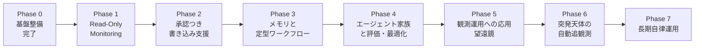

# ROADMAP — 開発ロードマップ

最終更新: 2026-11-16(ADR-0008 により優先順位を変更)

> Phase 2 以降は **Planned / Proposed** です。試験結果に応じて見直し、変更時は DEVELOPMENT_LOG に記録します。各フェーズは GitHub の Milestone に対応させます。

## 方針(Decided、[ADR-0008](DECISIONS/ADR-0008-general-purpose-agents-first.md))

- **当面:** 日々の研究・業務に役立つ汎用 AI-Agent を作りながら、エージェントの構成・ツール連携・メモリ・ワークフロー・マルチエージェント協調・評価を学ぶ。
- **将来:** そこで作った仕組みを、自前の電波望遠鏡の観測運用(さらに X 線衛星など)に応用する。
- **権限は段階的に広げる:** 読み取りのみ → 人間の承認つきで書き込み → 定期実行 → 自律性の拡大。

## 全体像

## フェーズ詳細

| Phase | 目標 | 主な用途 | 完了条件 | 状態 |
|-------|------|---------|---------|------|
| **0 基盤整備** | ドキュメント・管理ルール・テンプレート | — | 管理方針の承認、初回コミット | **完了**(2026-11-16 承認) |
| **1 Read-Only Monitoring** | 読み取り専用のエージェントで基本の仕組みを学ぶ | 文書への質問応答、文献調査、データ分析・コード読解、定型モニタリング、研究資金の公募調査 | [PHASE1_TEST_PLAN](EXPERIMENTS/PHASE1_TEST_PLAN.md) の 5 タスクの試験記録が揃い、知見が 3 件以上 KNOWLEDGE に追加される。タグ `v0.1.0` | **進行中**(Milestone 作成予定) |
| **2 承認つき書き込み支援** | 人間の承認を経て、ファイル作成・コード修正・文書作成を行う | コーディング支援、ドキュメント作成、研究資金の申請書作成支援、データ分析結果の保存 | 承認なしの書き込み 0 件。差分(diff)提示 → 承認 → 適用の流れが全タスクで動く | Planned |
| **3 メモリと定型ワークフロー** | 会話をまたぐ記憶、定期実行、状態管理 | 日次・週次の定型作業の自動化、研究の進捗管理 | メモリの有無で成績を比較した実験記録がある。定期実行が 2 週間問題なく動く | Planned |
| **4 エージェント家族と評価・最適化** | 役割分担の最適化、モデルの使い分け(商用 API / ローカル)、評価の自動化 | 研究支援の家族構成、正当な収益機会の調査、他分野(Web・ゲーム・資産管理)への展開 | 評価ハーネスで、構成の変更による改善を数値で示せる | Planned |
| **5 観測運用への応用** | 望遠鏡の状態監視(読み取り)→ データ処理 → スケジュール提案 → 承認つき運用制御 | 自前の電波望遠鏡 | 装置仕様・制御方式の確認(OPEN_ISSUES の保留項目)から開始 | Planned(構想) |
| **6 突発天体の自動追観測** | FRB などの検出・外部通知から追観測 | 電波望遠鏡 | 模擬トリガーで一連の流れが動く | Planned(構想) |
| **7 長期自律運用** | 人間の介入を最小限にした長期運用 | 観測システム全般 | Phase 6 完了後に定義 | Planned(構想) |

## Phase 1 の 5 タスク

| ID | タスク | 優先度 | 詳細 |
|----|--------|--------|------|
| P1-1 | 最小エージェント:リポジトリの文書に答える | high | [計画 §P1-1](EXPERIMENTS/PHASE1_TEST_PLAN.md#p1-1-最小エージェントリポジトリの文書に答える) |
| P1-2 | 文献調査エージェント | high | [計画 §P1-2](EXPERIMENTS/PHASE1_TEST_PLAN.md#p1-2-文献調査エージェント) |
| P1-3 | データ分析・コード読解エージェント | medium | [計画 §P1-3](EXPERIMENTS/PHASE1_TEST_PLAN.md#p1-3-データ分析コード読解エージェント) |
| P1-4 | MCP 連携による定型モニタリング | medium | [計画 §P1-4](EXPERIMENTS/PHASE1_TEST_PLAN.md#p1-4-mcp-連携による定型モニタリング日次ダイジェスト) |
| P1-5 | マルチエージェント調査+独立検証:研究資金の公募調査 | medium | [計画 §P1-5](EXPERIMENTS/PHASE1_TEST_PLAN.md#p1-5-マルチエージェント調査独立検証研究資金の公募調査) |

GitHub の Issue 番号は作成後に [OPEN_ISSUES](OPEN_ISSUES.md) と本表へ追記します。

## 次に取り組むこと

1. GitHub に push し、Milestone と Issue を作成する(`scripts/github/setup_phase1.sh`)
2. Phase 1 で使う商用 LLM API を決める(OPEN_ISSUES Q-05)
3. 開発言語を決めて P1-1 に着手する(Q-06)
