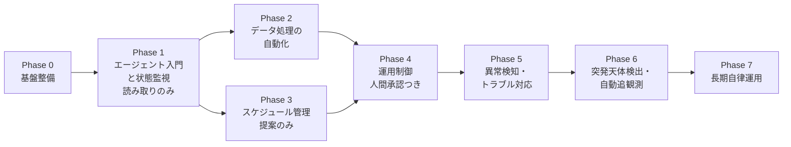

# ROADMAP — 開発ロードマップ

最終更新: 2026-11-16

> Phase 1 以降はすべて **Planned / Proposed** です。完了条件・順序は試験結果に応じて見直し、変更時は DEVELOPMENT_LOG に記録します。各フェーズは GitHub の Milestone に対応させます。

## 全体像

順序の考え方(Proposed):**リスクの低い「読む」機能から始め、装置を「動かす」機能は後にする。** ユーザーの構想リスト(状態監視 → スケジュール → 運用制御 → データ処理 → …)を、安全性の観点で並べ替えています。データ処理は装置を操作しないため早めに置いています。

## フェーズ詳細

| Phase | 目標 | 完了条件 | 優先度 | 状態 |
|-------|------|---------|--------|------|
| **0 基盤整備** | ドキュメント・管理ルール・テンプレートを整える | ユーザーが管理方針を承認し、初回コミット完了。最優先の未確認事項(望遠鏡の制御方式・計算機仕様)が整理される | 最高 | **進行中** |
| **1 エージェント入門と状態監視** | 最小のエージェントを自作し、装置状態・ログを **読み取って** 報告させる | (a) 試験課題 5 個以上を定義 (b) 読み取りツールのみで状態報告が正しく出る (c) 全ツール呼び出しがログに残る | 高 | Planned |
| **2 データ処理の自動化** | 観測データの定型処理をワークフローとして自動化し、結果の要約をエージェントに作らせる | 既知の結果があるデータで処理結果が一致する | 高 | Planned |
| **3 スケジュール管理(提案)** | 観測スケジュール案を作成・確認させる(実行はしない) | 人間が作った計画との比較で、制約違反(可視性・装置制約)がゼロ | 中 | Planned |
| **4 運用制御(承認つき)** | 観測開始・終了などの操作を、人間の承認後に実行 | ガードレールの試験(禁止操作の拒否)に全て合格。承認なしの操作がゼロ | 中 | Planned |
| **5 異常検知・トラブル対応** | 異常を検知し、原因推定と対処案を出す | 過去の障害事例(または模擬障害)で原因推定が妥当と判定される | 中 | Planned |
| **6 突発天体の検出・自動追観測** | FRB などの検出・外部通知から追観測計画を作り実行 | 模擬トリガーで一連の流れが動く。初期は人間承認、実績後に一部自動化 | 低(将来) | Planned(構想) |
| **7 長期自律運用** | 長期間、人間の介入を最小限にして運用 | 定義は Phase 5 完了後に決める | 低(将来) | Planned(構想) |

## 横断的な取り組み

| 項目 | 内容 | 状態 |
|------|------|------|
| 評価の仕組み | 各フェーズで試験課題と合格基準を定め、`docs/EXPERIMENTS/` に記録 | Proposed |
| 汎用化 | 装置インターフェースを差し替え可能にし、X 線衛星などへの応用を見据える | Planned |
| エージェント家族への拡張 | 単一エージェントで限界が見えたら、検証役などを分割([ADR-0007](DECISIONS/ADR-0007-start-with-single-agent.md)) | Proposed |
| 他分野への展開 | Web 制作、ゲーム開発、資産管理などへの「作り方」の再利用([references](references/agent-family-playbook.md)) | Proposed |

## 次に取り組むこと(Phase 0 の残り)

1. このドキュメント基盤の内容確認・承認(ユーザー)
2. 初回コミット(ユーザーの許可後)
3. [OPEN_ISSUES](OPEN_ISSUES.md) の Q-01〜Q-04 に回答
4. Phase 1 用の GitHub Issue と Milestone を作成
