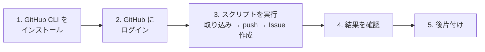

# 手順書:GitHub CLI の初期設定と、AI が作った変更の取り込み・公開

- **対象:** Git / GitHub をほとんど使ったことがない人
- **所要時間:** 15〜30 分
- **最終更新:** 2026-11-16
- **根拠:** 2026-11-16 に開発者が実際に実行した出力ログ(本書の「実際の出力」はすべてそのログからの抜粋で、Confirmed)
- **関連:** [DEVELOPMENT_GUIDELINES](../DEVELOPMENT_GUIDELINES.md)、[TROUBLESHOOTING](../TROUBLESHOOTING.md)、LOG-20261116-04

---

## 0. この手順書でできること

AI(Claude など)が作ったドキュメントやコードを、自分の Mac のリポジトリに取り込み、GitHub に公開(push)し、作業管理用の Issue を作成するまでを行います。



### なぜ人間の Mac から実行するのか
今回使った AI の作業環境には、GitHub への **書き込み権限がありませんでした**(読むことはできる)。そこで AI は変更を「バンドル」という 1 つのファイルにまとめて Mac に置き、最後の公開だけを人間が行う形にしました。詳しくは [TROUBLESHOOTING T-02](../TROUBLESHOOTING.md)。

---

## 1. はじめに知っておく用語

| 用語 | 意味 |
|------|------|
| **ターミナル** | 文字でコマンドを打って Mac を操作するアプリ(「アプリケーション → ユーティリティ → ターミナル」) |
| **プロンプト** | ターミナルの行頭に出る `(base) massa@... AI-agents-family %` の部分。ここにコマンドを入力する。`%` の右に打ち、Enter で実行 |
| **Git** | ファイルの変更履歴を記録する道具 |
| **GitHub** | Git の履歴をインターネット上で保管・共有するサービス |
| **リポジトリ** | Git で管理されている 1 つのプロジェクトのフォルダ |
| **コミット** | 変更をひとまとまりとして履歴に記録したもの。`c2dc48e` のような ID が付く |
| **push(プッシュ)** | 自分の Mac のコミットを GitHub に送ること |
| **GitHub CLI(`gh`)** | GitHub の操作(ログイン、Issue 作成など)をターミナルから行うための公式ツール |
| **Homebrew(`brew`)** | Mac にツールをインストールするための道具 |
| **認証(ログイン)** | 「自分が本人である」ことを GitHub に示すこと |
| **SSH 鍵** | パスワードの代わりに使う、本人確認用の鍵ファイル(`~/.ssh/id_rsa` と `id_rsa.pub` の組) |
| **トークン** | パスワードの代わりに使う、期限や権限を限定できる文字列。**他人に見せてはいけない** |
| **バンドル(bundle)** | コミットを 1 つのファイルにまとめたもの。ネットを使わずにコミットを受け渡せる |
| **stash(スタッシュ)** | まだコミットしていない変更を、一時的に退避(保管)しておく機能 |
| **Issue / Milestone** | GitHub 上の作業票 / 作業票をまとめる目標(本プロジェクトでは開発フェーズ) |

---

## 2. 前提

- macOS(Apple Silicon で確認)
- Homebrew がインストール済み(未導入なら https://brew.sh の手順に従う)
- GitHub のアカウントを持っている
- 対象リポジトリが Mac にある:`~/Desktop/AI-agent/github/AI-agents-family`

まずターミナルを開き、リポジトリのフォルダへ移動します。

```bash
cd ~/Desktop/AI-agent/github/AI-agents-family
```

行頭が `... AI-agents-family %` になっていれば OK です。

---

## 3. Step 1:GitHub CLI をインストールする

```bash
brew install gh
```

**実際の出力(すでに入っていた場合):**
```
Warning: gh 2.104.0 is already installed and up-to-date.
```
→ `Warning` と出ますが **問題ありません**。「もう最新版が入っている」という意味です。

---

## 4. Step 2:GitHub にログインする

```bash
gh auth login
```

いくつか質問されます。矢印キー(↑↓)で選び、Enter で決定します。

| 質問 | 意味 | 選ぶもの |
|------|------|---------|
| `Where do you use GitHub?` | どの GitHub を使うか | **GitHub.com** |
| `How would you like to authenticate GitHub CLI?` | ログイン方法 | **Login with a web browser**(推奨、方法 A)または Paste an authentication token(方法 B) |
| `What is your preferred protocol for Git operations on this host?` | push などの通信方式 | **SSH**(SSH 鍵がある場合)/ 分からなければ HTTPS |
| `Upload your SSH public key to your GitHub account?` | SSH 鍵を GitHub に登録するか | 既存の鍵(例:`~/.ssh/id_rsa.pub`)を選ぶ。すでに登録済みでも害はない |
| `Title for your SSH key:` | 鍵の名前 | 分かりやすい名前(例:`ai-agents-family`) |

### 方法 A:ブラウザでログイン(推奨)

```
! One-time code (7F50-E7BF) copied to clipboard
Press Enter to open https://github.com/login/device in your browser...
```

1. 表示された 8 桁のコード(例:`7F50-E7BF`)は **自動でコピー済み** です。
2. **Enter を押す**(ここで `Ctrl + C` を押すと中断されます。実際のログでは一度ここで中断しています)。
3. ブラウザが開くので、GitHub にログインし、コードを貼り付けて **Authorize** を押す。
4. ターミナルに `✓ Logged in as <ユーザー名>` と出れば完了。

### 方法 B:トークンを貼り付けてログイン(実際に使った方法)

1. ブラウザで https://github.com/settings/tokens を開き、トークンを作成する。
   - 必要な権限(scope):**`repo`、`read:org`、`admin:public_key`**(ターミナルにも表示されます)
   - **有効期限(Expiration)を必ず設定する**(例:30〜90 日)
2. 作成されたトークンをコピーし、`Paste your authentication token:` に貼り付けて Enter。
   - 入力中は `****` と表示され、文字は見えません。これは正常です。

**実際の出力(成功時):**
```
✓ Configured git protocol
✓ SSH key already existed on your GitHub account: /Users/massa/.ssh/id_rsa.pub
✓ Logged in as Hiroto-Masaoka
```

### ログインできたか確認する

```bash
gh auth status
```
`Logged in to github.com account <ユーザー名>` と出れば OK。

> ⚠️ **トークンの取り扱い:** トークンはパスワードと同じです。チャット(AI を含む)やファイル、リポジトリに貼り付けないでください。漏れた可能性があれば、https://github.com/settings/tokens ですぐに削除(Revoke)してください。

---

## 5. Step 3:スクリプトを実行する(取り込み → push → Issue 作成)

リポジトリのフォルダで次を実行します。

```bash
bash _from_claude/apply_and_push.sh
```

スクリプトは 4 つのことを順に行います。出力の読み方は次のとおりです。

### ① 未コミットの変更を退避(stash)
```
Saved working directory and index state On main: claude-pre-sync 2026-11-16(コミット d828da6 と同内容)
```
→ 以前に置かれていた未コミットのファイルを一時保管しました。**消えたわけではありません**(§7 で扱いを説明)。

### ② コミットを取り込む(fast-forward)
```
Updating c325ddb..c2dc48e
Fast-forward
 .github/ISSUE_TEMPLATE/bug.md   |  20 ++
 ...
 46 files changed, 2488 insertions(+), 1 deletion(-)
```
→ `Fast-forward` は「履歴を書き換えず、新しいコミットを後ろに付け足しただけ」という意味で、最も安全な取り込み方です。`+` は追加された行数です。

```
c2dc48e (HEAD -> main) docs: 汎用エージェント優先へ方針変更し Phase 1 試験計画を追加
d828da6 docs: リポジトリ管理基盤を整備
c325ddb (origin/main, origin/HEAD) Initial commit
```
→ Mac(`HEAD -> main`)は最新ですが、GitHub(`origin/main`)はまだ古い状態です。次の push で揃います。

### ③ GitHub に公開(push)
```
To github.com:Hiroto-Masaoka/AI-agents-family.git
   c325ddb..c2dc48e  main -> main
```
→ GitHub の `main` が `c325ddb` から `c2dc48e` に更新されました。

### ④ ラベル・Milestone・Issue の作成
```
== ラベル(DEVELOPMENT_GUIDELINES §4)
  type:task
  ...
== Milestone
  作成: Phase 1 - Read-Only Monitoring
== Issues
https://github.com/Hiroto-Masaoka/AI-agents-family/issues/1
...
https://github.com/Hiroto-Masaoka/AI-agents-family/issues/5
```
→ 作成された Issue の URL が表示されます。

```
Showing 4 of 4 issues ...
```
→ 最後の一覧で 5 件中 4 件しか出ないことがあります。**GitHub の検索への反映が数秒遅れるだけ** で、Issue は 5 件とも作成されています(§6 で確認)。

最後に `完了。` と表示されれば成功です。

---

## 6. Step 4:結果を確認する

### GitHub 上で確認
- Milestone:https://github.com/Hiroto-Masaoka/AI-agents-family/milestone/1 (Issue が 5 件あること)
- Issue 一覧:https://github.com/Hiroto-Masaoka/AI-agents-family/issues

### ターミナルで確認
```bash
git status            # "Your branch is up to date with 'origin/main'." なら Mac と GitHub が一致
git log --oneline -3  # 一番上が最新のコミット
git stash list        # ① で退避した変更が 1 件あるはず
gh issue list --milestone "Phase 1 - Read-Only Monitoring"
```

---

## 7. Step 5:後片付け

### 退避した変更(stash)を消す
退避した内容は、取り込んだコミットに **同じ内容が含まれています**。確認できたら削除してかまいません。

```bash
git stash list    # 対象が "claude-pre-sync ..." であることを確認
git stash drop    # 最新の 1 件を削除
```
> 迷ったら残しておいても害はありません。中身を見るには `git stash show -p`。

### 受け渡し用フォルダを消す
```bash
rm -r _from_claude
```
`_from_claude/` は Git の管理対象外なので、消しても履歴には影響しません。

---

## 8. うまくいかないとき

| 症状(出力) | 原因 | 対処 |
|-------------|------|------|
| `fatal: Unimplemented pathspec magic '_' in ':!_from_claude'` | 古い版のスクリプトの不具合 | 修正版(`':(exclude)_from_claude'` を使う版)で再実行。[T-03](../TROUBLESHOOTING.md) |
| `error: Your local changes to the following files would be overwritten by merge` / `untracked working tree files would be overwritten` | 未コミットのファイルが残ったまま取り込もうとした。**取り込みは中止され(`Aborting`)、何も変わっていない** | 修正版スクリプトを再実行(自動で退避する)。手動なら `git stash push -u` の後に再実行 |
| `GitHub CLI がありません` | `gh` 未インストール | Step 1 |
| `gh にログインしていません` | 未ログイン・トークン期限切れ | Step 2 |
| `Permission denied (publickey)` | SSH 鍵が GitHub に登録されていない | `gh auth login` で鍵を登録する、または通信方式を HTTPS にする:`gh config set -h github.com git_protocol https` |
| `fatal: Not possible to fast-forward` | GitHub 側に別の変更が先に入った | 無理に進めず、AI または詳しい人に状況(`git log --oneline -5` と `git status` の出力)を共有する |
| 最後の一覧が 4 件しか出ない | 検索の反映遅延 | 数秒後に `gh issue list` で再確認 |
| 一度目の `gh auth login` が止まった | `Press Enter...` で `Ctrl + C` を押して中断した | もう一度 `gh auth login` を実行 |

---

## 9. 次回以降(AI から変更を受け取るときの一般的な流れ)

AI から新しいバンドルを受け取ったときも、同じ流れです。

```bash
cd ~/Desktop/AI-agent/github/AI-agents-family
git status                                   # 未コミットの変更がないことを確認
git pull --ff-only _from_claude/<名前>.bundle main   # 取り込み(履歴の書き換えなし)
git push origin main                          # 公開
```

AI の作業環境に GitHub の書き込み権限を与えれば(Claude の場合は [Claude GitHub App](https://github.com/apps/claude/installations/select_target) をこのリポジトリにインストール)、この手順自体が不要になります([OPEN_ISSUES Q-10](../OPEN_ISSUES.md))。
