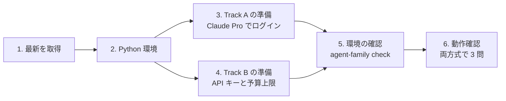

# 手順書:P1-0 の環境構築と、2 方式(Track A / B)の動作確認

- **対象:** Python の仮想環境やコマンド操作に慣れていない人
- **所要時間:** 30〜45 分
- **最終更新:** 2026-11-17
- **関連:** Issue [#6](https://github.com/Hiroto-Masaoka/AI-agents-family/issues/6)、[ADR-0012](../DECISIONS/ADR-0012-dual-track-comparison.md)、[src/README](../../src/README.md)
- **状態:** 手順は AI が作成。開発者の Mac での実行結果は未確認(Unverified)。実行したら出力に合わせて本書を更新する

## 0. 全体像



## 1. 最新を取得する

```bash
cd ~/Desktop/AI-agent/github/AI-agents-family
git pull
```

## 2. Python 環境を作る

**仮想環境** とは、このプロジェクト専用の Python の部屋です。他のプロジェクトのライブラリと混ざらないようにします。

anaconda を使っている場合の例(Python 3.10 以上):

```bash
conda create -n agent-family python=3.12 -y
conda activate agent-family
pip install -e ".[all]"
```

- `-e`:このフォルダのコードを編集すると、すぐに反映される形でインストールする
- `.[all]`:Track A 用(claude-agent-sdk)、Track B 用(anthropic)、試験用(pytest)をまとめて入れる

成功の目印:`pytest` を実行して `16 passed` と出る(LLM には接続しない試験です)。

```bash
pytest -q
```

> 環境管理ツール(uv / conda / venv)の正式な選択は ADR-0010 に追記します。conda を使った場合はそう記録します。

## 3. Track A の準備(Claude Pro でログイン)

Track A は Claude Code の仕組みを使います。Claude Code(`claude` コマンド)が入っていて、Pro アカウントでログイン済みである必要があります。

```bash
claude        # 起動したら /login と入力し、Pro アカウントでログイン。終わったら /exit
```

> Track A の実行中は、プログラムが `ANTHROPIC_API_KEY` を一時的に外します。API キー(従量課金)ではなく Pro の枠が使われるようにするためです。

## 4. Track B の準備(API キーと予算上限)

1. Claude Console で API キーを作成する。
2. Console の利用上限(Limits)を **月 30 USD** に設定する(ADR-0012)。
3. キーを `.env` に保存する:

```bash
cp .env.example .env
open -e .env      # テキストエディタで開き、ANTHROPIC_API_KEY= の後ろにキーを貼って保存
```

- `.env` は Git の管理対象外です(`git status` に出てこないことを確認)。
- キーはチャット(AI を含む)に貼らないでください。
- プログラム側にも予算の安全装置があります。`logs/runtime/spend.jsonl` に利用額を記録し、月 30 USD を超えそうなら実行しません(Console の上限との二重の守り)。

## 5. 環境を確認する

```bash
agent-family check
```

期待される出力(すべて ✅):

```
== Track A(Agent SDK・Pro 枠)
  ✅ claude-agent-sdk パッケージ
  ✅ claude コマンド(Claude Code)
== Track B(API 直接・従量課金)
  ✅ anthropic パッケージ
  ✅ ANTHROPIC_API_KEY(値は表示しません)
  今月のローカル記録の利用額: $0.0000 / 予算 $30.00
```

## 6. 動作確認(両方式で 3 問)

まず 1 問ずつ:

```bash
agent-family ask --track a "README.md を読んで、現在の開発フェーズを答えて"
agent-family ask --track b "README.md を読んで、現在の開発フェーズを答えて"
```

次に、試験課題 3 問(フェーズの確認、ADR の読み取り、`.env` の読み取り拒否)を両方式で実行して比較表を出す:

```bash
agent-family eval --tracks a,b evals/p1-0_smoke.json
```

- 出力の表(Markdown)は、そのまま EXP 記録に貼れます。
- 「読み取り専用の検証」が **✅ 変更なし** であることを確認します。
- Track B の費用の目安:3 問 × 数ステップで数セント程度(Sonnet 5.5)。

## 7. 結果の共有

出力をそのまま AI に渡せば、EXP 記録(`docs/EXPERIMENTS/EXP-YYYYMMDD-p1-0-smoke.md`)と開発ログの作成を任せられます。**`.env` の中身やキーは含めないでください**(`agent-family` の出力にキーは表示されません)。

## 8. うまくいかないとき

| 症状 | 原因 | 対処 |
|------|------|------|
| `Track B には anthropic パッケージが必要です` | Track B 用ライブラリ未導入 | `pip install -e ".[api]"` |
| `ANTHROPIC_API_KEY が設定されていません` | `.env` がない・キーが空 | §4 |
| `予算 $30.00 を超えるため実行しません` | 今月のローカル記録が上限に近い | 実行を止めて記録を確認(`logs/runtime/spend.jsonl`) |
| Track A で認証エラー | Claude Code に未ログイン | §3 |
| `agent-family: command not found` | 仮想環境が有効でない | `conda activate agent-family` |
